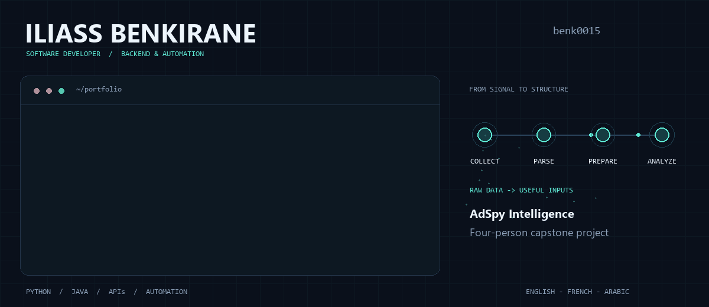

  

  <strong>Backend development · Python automation · AI-enabled applications</strong> 
  Ottawa, Canada &nbsp; / &nbsp; English · Français · العربية

  <a href="https://github.com/benk0015/Adspy-Intelligence"><strong>AdSpy Intelligence</strong></a>
  &nbsp; · &nbsp;
  <a href="https://github.com/benk0015/Adspy-Intelligence/blob/main/docs/SCRAPING.md"><strong>Scraping walkthrough</strong></a>
  &nbsp; · &nbsp;
  <a href="https://github.com/benk0015?tab=repositories"><strong>Explore my repositories</strong></a>

## Hi, I'm Iliass

I'm a software developer and **Computer Engineering Technology – Computing Science graduate from Algonquin College**. I build backend services, integrate APIs, and automate data workflows with Python.

My experience spans delivery-platform backends, application testing, and IT/network security. I like working where those pieces meet: making services communicate, turning messy responses into structured data, and troubleshooting what happens along the way.

## Featured work / AdSpy Intelligence

**Collect advertising data. Prepare creative assets. Support AI-assisted research.**

AdSpy is an advertising intelligence platform developed by a **four-person team** for Inbox Communications Inc. It connects multi-platform data collection to creative analysis, reports, and a web dashboard.

My contribution focused on **Python scraping, data ingestion, and image processing**:

- Collected ad-library data through third-party APIs, query-driven requests, pagination, and structured JSON exports.
- Used Python and Pillow to download images, combine carousel creatives, resize assets, and organize analysis inputs.
- Prepared advertising metadata and visual inputs for n8n/LLM-assisted analysis workflows.
- Collaborated within a React/TypeScript application backed by AWS serverless services.

**[Explore the project →](https://github.com/benk0015/Adspy-Intelligence)** &nbsp; [Read the scraping walkthrough](https://github.com/benk0015/Adspy-Intelligence/blob/main/docs/SCRAPING.md) &nbsp; [Inspect sample outputs](https://github.com/benk0015/Adspy-Intelligence/tree/main/docs/samples)

The screenshot shows the shared team application. The terminal banner is an illustration, not a live execution log.

## Experience

| Role | Work |
|---|---|
| **Software Developer · Delivrin** 2022–2023 | Integrated mapping, geolocation, and payment APIs; worked on authentication and secure communications; troubleshot tracking and order-management systems. |
| **Software Developer · CHOP Africa** 2021–2022 | Developed backend services and REST APIs for food-delivery operations; tested and debugged functionality and supported service monitoring. |
| **IT & Network Security Intern · PAP SAC Maghreb SA** 2021 | Supported network assessments, firewall/access-control activities, endpoint troubleshooting, and server backup/recovery. |

## Technical toolkit

| Area | Technologies |
|---|---|
| **Programming & data** | Python, Java, SQL, JSON, Requests, Pillow |
| **APIs & automation** | REST APIs, web scraping, Playwright, ScrapeCreators, n8n |
| **Team application stack** | React, TypeScript, AWS Lambda, API Gateway, S3, DynamoDB |
| **Development & systems** | Git, testing, debugging, Linux, Windows, TCP/IP, DNS, HTTP/HTTPS |

## Education & languages

**Advanced Diploma · Computer Engineering Technology – Computing Science**  
Algonquin College, Ottawa · 2022–2026

**Integrated Preparatory Cycle for Engineers · AI Department**  
Euromed University, Fez · 2020–2022

English · French · Arabic

---

Build useful tools. Understand the data. Keep learning.

